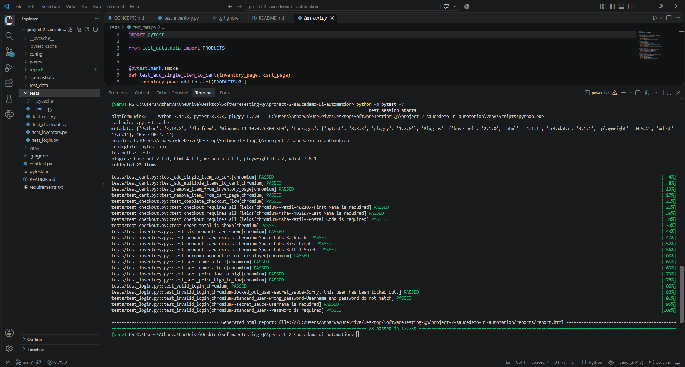
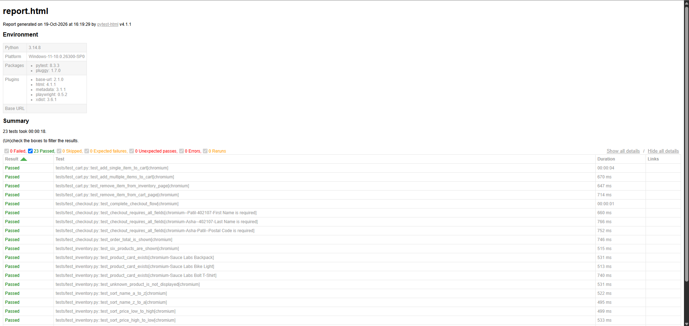
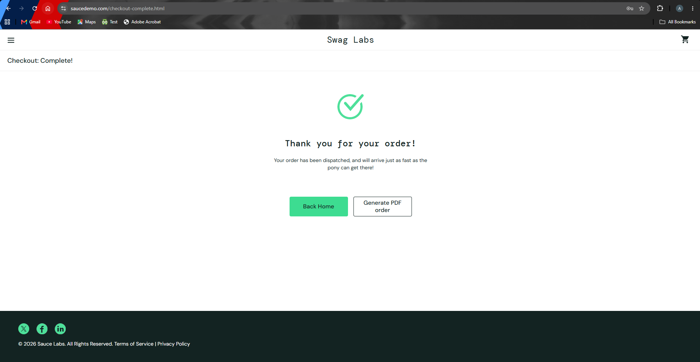

# SauceDemo UI Tests

I built this project to practise testing a shopping website with Python and Playwright. The tests check login, products, sorting, the cart, and checkout.

## Test results

I ran the full test suite on Windows 11 with Chromium.

| Result | Count |
|---|---:|
| Passed | 23 |
| Failed | 0 |
| Skipped | 0 |
| Errors | 0 |
| Run time | 17.73 seconds |

These results are from one test run using `python -m pytest -v`.

### Test run



### HTML report



## Screenshots

### Products page


### Checkout complete



## What the tests check

- Login with valid and invalid details
- Login errors for missing details and a locked account
- Product names and the number of products shown
- Sorting products by name and price
- Adding products to the cart and removing them
- Checkout form validation
- Completing an order and checking that the total is shown

## Tools used

- **Python** — test code
- **Playwright** — controls the browser
- **Pytest** — runs the tests and checks the results
- **Page Object Model** — keeps page actions separate from test cases
- **pytest-html** — creates the HTML report

## Run the tests

### 1. Get the project

```bash
git clone https://github.com/AtharvaN11/project-2-saucedemo-ui-automation.git
cd project-2-saucedemo-ui-automation
```

### 2. Create a virtual environment

On Windows PowerShell:

```powershell
python -m venv venv
.\venv\Scripts\Activate.ps1
```

On macOS or Linux:

```bash
python3 -m venv venv
source venv/bin/activate
```

### 3. Install the packages and browser

```bash
python -m pip install -r requirements.txt
python -m playwright install chromium
```

### 4. Run the tests

```bash
python -m pytest -v
```

The HTML report is saved to `reports/report.html` after the run.

To run only smoke or regression tests:

```bash
python -m pytest -m smoke
python -m pytest -m regression
```

The `prod` and `staging` settings currently use the same SauceDemo website. They show how the base URL can be selected; they are not separate test environments.

## Project structure

```text
project-2-saucedemo-ui-automation/
├── config/       # Website settings
├── pages/        # Page actions and locators
├── test_data/    # Test data
├── tests/        # Login, inventory, cart, and checkout tests
├── screenshots/  # Screenshots used in this README
├── reports/      # Generated HTML report
├── conftest.py   # Shared test setup
├── pytest.ini    # Pytest settings
└── requirements.txt
```

## Next steps

- Run the tests in another browser.
- Add the tests to a GitHub Actions workflow.

## Author

**Atharva Prakash Nandgaonkar**  
[GitHub profile](https://github.com/AtharvaN11)
